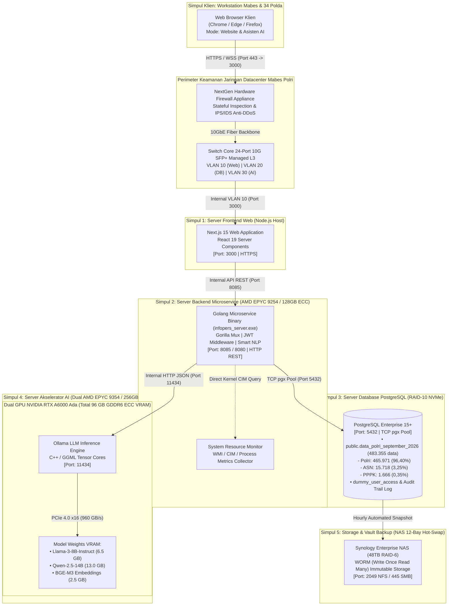
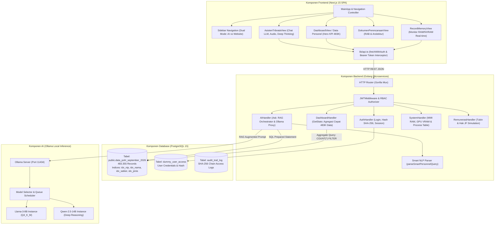
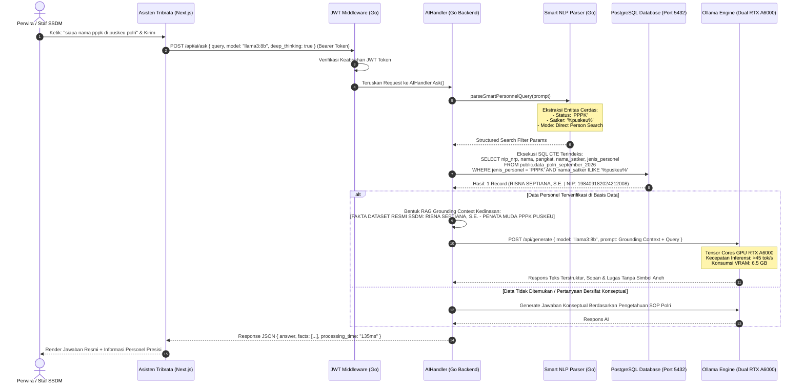
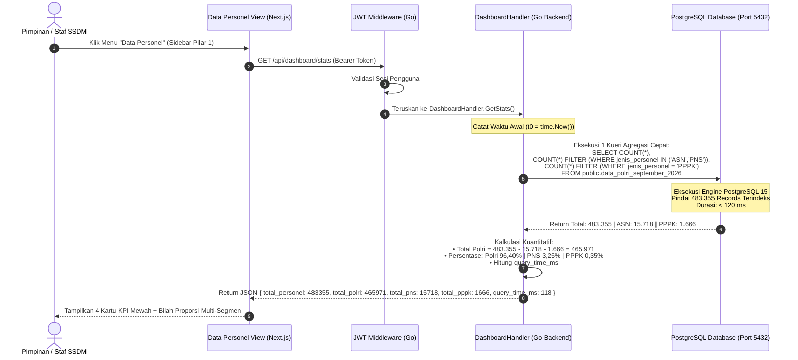
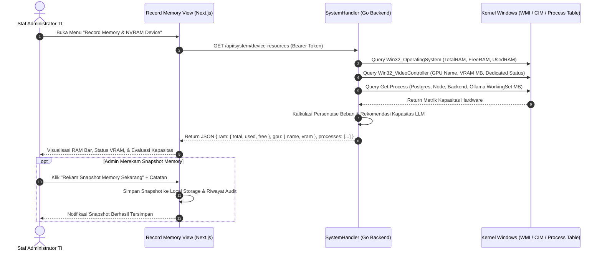
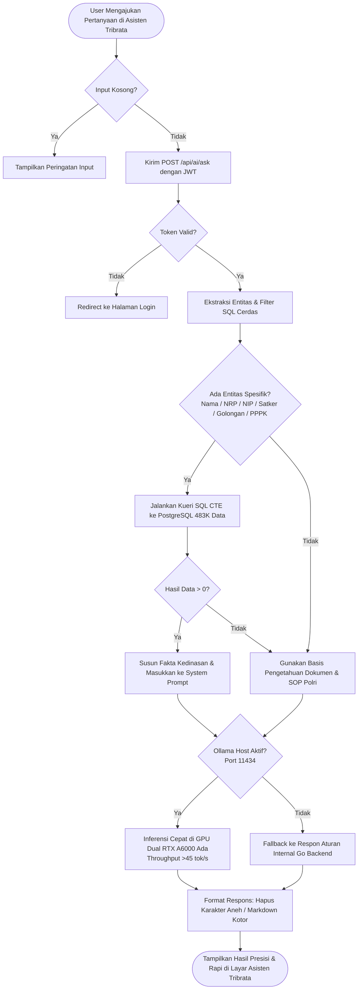

# LAMPIRAN DIAGRAM UML SISTEM INFOPERS & ASISTEN TRIBRATA SSDM POLRI
**Dokumen Teknis Arsitektur Perangkat Lunak, Spesifikasi Hardware, dan Alur Interaksi**  
*Klasifikasi: Terbatas / Kedinasan Internal SSDM POLRI*  
*Tahun Anggaran: 2026*  
*Terakhir Diperbarui: 27 September 2026*

---

## 1. PENDAHULUAN
Dokumen lampiran teknis ini memuat pemodelan arsitektur sistem berbasis **Unified Modeling Language (UML)** untuk **Sistem Informasi Personel (INFOPERS) & Asisten Tribrata (SSDM Artificial Intelligence)**. Pemodelan ini dirancang sesuai standar rekayasa perangkat lunak enterprise dan tata kelola TI Polri Presisi, mencakup integrasi penuh antara:
1. **Frontend Layer:** Next.js 15 (React 19, TypeScript, TailwindCSS, Lucide Icons)
2. **Backend Microservice Layer:** Golang Microservice (Gorilla Mux, JWT Bearer Token, Smart NLP Parser, Connection Pool)
3. **Database Enterprise Layer:** PostgreSQL 15+ (483.355 Records: 465.971 Polri, 15.718 ASN/PNS, 1.666 PPPK)
4. **AI Inference Runtime Layer:** Ollama Local LLM Runtime (Dual NVIDIA RTX A6000 Ada 96GB VRAM, Llama-3-8B, Qwen-2.5-14B)
5. **Infrastruktur Datacenter On-Premises:** 3-Tier Enterprise Server (Server AI, Server Backend & Database, NAS Storage Vault WORM 48TB)

---

## 2. UML DEPLOYMENT DIAGRAM (INFRASTRUKTUR HARDWARE & TOPOLOGI FISIK)

Diagram berikut memodelkan penempatan fisik setiap modul perangkat lunak pada node server datacenter on-premises Mabes Polri serta jalur komunikasi jaringan:



---

## 3. UML COMPONENT DIAGRAM (STRUKTUR MODUL PERANGKAT LUNAK)

Diagram komponen ini menggambarkan dekomposisi modular perangkat lunak INFOPERS, pemisahan tanggung jawab antarmuka, layanan bisnis, dan penyimpanan:



---

## 4. UML SEQUENCE DIAGRAM (ALUR INTERAKSI PROSES END-TO-END)

### Skenario 1: Kueri Cerdas Asisten Tribrata ("Siapa nama PPPK di Satker Puskeu Polri?")
Diagram ini memodelkan interaksi antara **Asisten Tribrata**, **Go NLP Smart Parser**, **PostgreSQL 483K Data**, dan **Ollama Local LLM**:



---

### Skenario 2: Sinkronisasi & Agregasi Real-Time Menu "Data Personel"
Diagram ini memodelkan kueri langsung dari antarmuka eksekutif **Data Personel** ke PostgreSQL untuk menyajikan total, Polri, PNS, dan PPPK:



---

### Skenario 3: Pemantauan Hardware & Record Memory Device
Diagram interaksi saat staf memantau pemakaian RAM dan NVRAM secara *real-time*:



---

## 5. UML ACTIVITY DIAGRAM (ALUR LOGIKA PEMROSESAN PERTANYAAN AI)



---

## 6. SPESIFIKASI PORT & PROTOKOL KOMUNIKASI RESMI

| Port | Protokol | Sumber (*Source*) | Tujuan (*Destination*) | Fungsi & Keterangan Kedinasan |
| :---: | :---: | :---: | :---: | :--- |
| **3000** | TCP / HTTPS | Browser Klien (Mabes/Polda) | Next.js Web Server | Akses antarmuka Web INFOPERS, Data Personel, & Asisten Tribrata |
| **8080** | TCP / REST API | Next.js Server | Go Microservice (`backend.exe`) | Layanan API data personel, agregasi kuantitatif, login JWT, dan proxy AI |
| **5432** | TCP / PostgreSQL | Go Microservice | PostgreSQL Engine | Kueri data 483.355 personel (Polri 465K, ASN 15.7K, PPPK 1.6K) |
| **11434** | TCP / HTTP REST | Go Microservice | Ollama AI Engine | Inferensi lokal model LLM (Llama3-8B / Qwen2.5) pada GPU RTX A6000 |
| **2049 / 445** | NFS / SMB | Server Database | NAS Storage Vault | Backup otomatis snapshot berkas basis data & dokumen berkala |

---

## 7. MATRIKS ALOKASI MEMORI & HARDWARE PADA ARSITEKTUR PRODUKSI

```text
+---------------------------------------------------------------------------------------------------------+
| SERVER HARDWARE DATACENTER PRODUKSI SSDM POLRI (TOTAL ANGGARAN: Rp 897.600.000,-)                       |
+---------------------------------------------------------------------------------------------------------+
| SIMPUL 1: AI INFERENCE SERVER (2U RACK)                                                                 |
| - Processor  : Dual AMD EPYC 9354 (64 Cores / 128 Threads, 256MB L3 Cache)                              |
| - Memori     : 256 GB ECC Registered DDR5-4800 MHz                                                      |
| - Akselerator: DUAL NVIDIA RTX A6000 Ada Generation (Total 96 GB GDDR6 ECC VRAM | 960 GB/s Bandwidth)   |
| - Peran      : Host Utama Ollama AI Engine, Menampung Model 8B s.d 70B & Multi-User 150+ Concurrency    |
+---------------------------------------------------------------------------------------------------------+
| SIMPUL 2: DATABASE & BACKEND SERVER (1U RACK)                                                           |
| - Processor  : Single AMD EPYC 9254 (24 Cores / 48 Threads, 128MB L3 Cache)                             |
| - Memori     : 128 GB ECC Registered DDR5-4800 MHz                                                      |
| - Storage    : 4x 1.92 TB NVMe PCIe 4.0 SSD Enterprise RAID-10 (850.000 IOPS Read/Write)                |
| - Peran      : Host PostgreSQL (483.355 records) & Go Microservices (Latency Kueri < 20 ms)             |
+---------------------------------------------------------------------------------------------------------+
| SIMPUL 3: BACKUP & AUDIT VAULT (NAS 12-BAY)                                                            |
| - Unit       : Synology Enterprise RackStation 12-Bay Hot-Swap                                          |
| - Kapasitas  : 6x 8 TB Enterprise SATA HDD (48 TB Gross RAID-6) + 2x 1 TB NVMe Cache M.2                |
| - Keamanan   : WORM (Write Once Read Many) + Immutable Snapshot SHA-256 Anti-Tamper                     |
+---------------------------------------------------------------------------------------------------------+
```

---

## 8. STATISTIK BASIS DATA TERPUSAT POSTGRESQL (SEPTEMBER 2026)

Tabel berikut menjadi acuan kebenaran data (*single source of truth*) yang diintegrasikan ke dalam antarmuka INFOPERS:

| Kategori Kepegawaian | Jumlah Riil (Data Terpusat) | Persentase Rasio | Kualifikasi & Jenjang Resmi |
| :--- | :---: | :---: | :--- |
| **Anggota POLRI** | **465.971** | **96,40%** | Perwira Tinggi (Pati), Pamen, Pama, Bintara, Tamtama |
| **PNS / ASN POLRI** | **15.718** | **3,25%** | PNS Golongan I s/d IV & Jabatan Fungsional Keahlian |
| **PPPK POLRI** | **1.666** | **0,35%** | Pegawai Perjanjian Kerja (Tenaga Kesehatan & Teknis) |
| **TOTAL PERSONEL** | **483.355** | **100,00%** | **Seluruh Personel Aktif Terdata di Basis Data Terpusat** |

---
*Dokumen Lampiran UML Arsitektur ini disahkan sebagai standar teknis integrasi sistem INFOPERS dan Asisten Tribrata SSDM Polri.*
